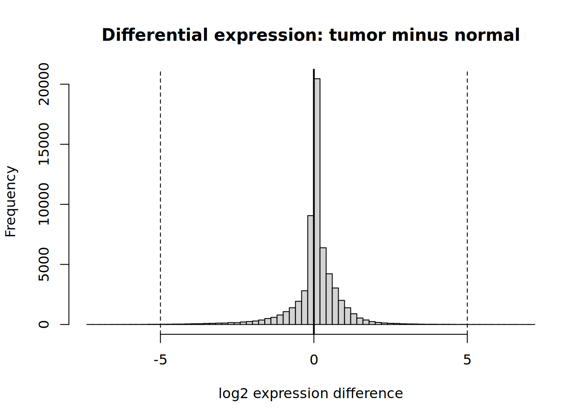
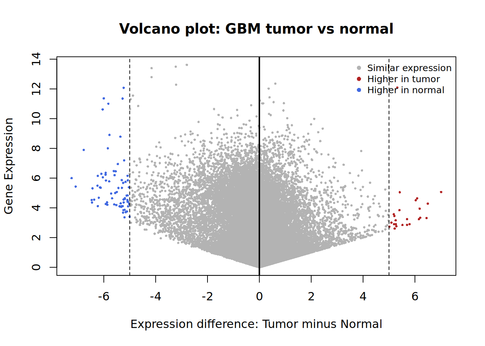
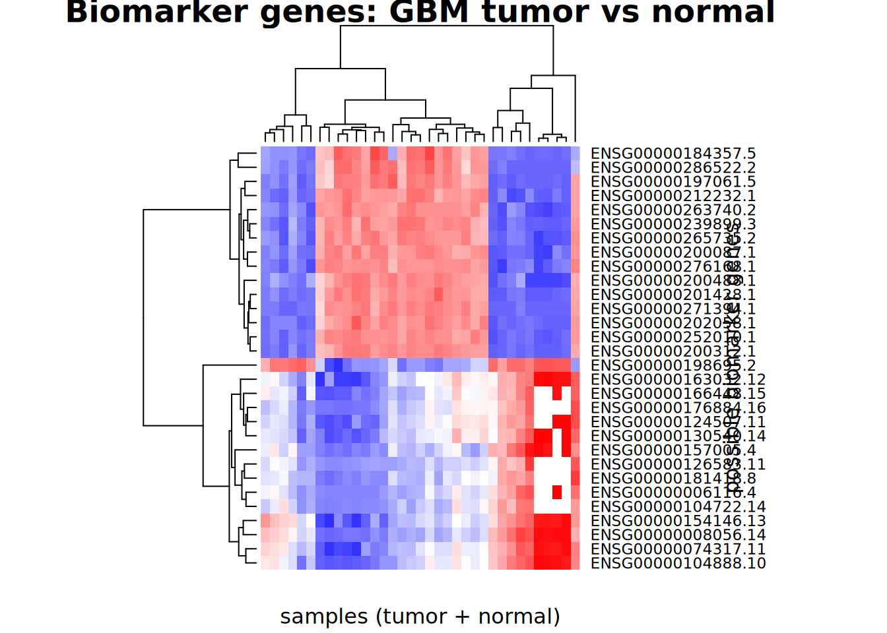
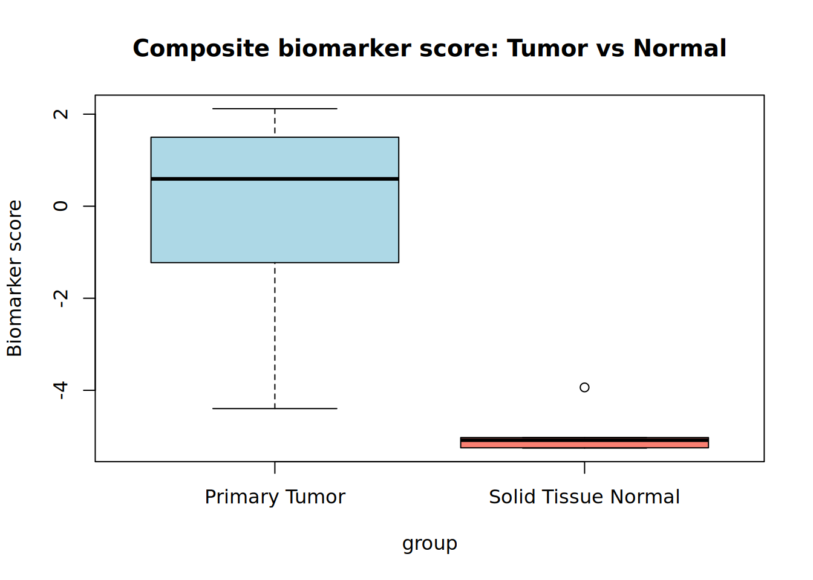

# DREAM-High: Computational Glioblastoma Biomarker Development

Researchers: Sinchana Joshi and Musfirah Soheil
Research Program: DREAM-High  
Tools: R, TCGAbiolinks, SummarizedExperiment

Overview:

This project explores whether gene-expression patterns can distinguish primary glioblastoma tumors from normal brain tissue. Using publicly available data from The Cancer Genome Atlas (TCGA), I developed a preliminary 30-gene expression signature and evaluated its ability to separate tumor and normal samples.

Methods:

- Loaded RNA-sequencing data containing 60,660 genes across 391 samples.
- Applied a log2(TPM + 1) transformation to normalize the scale of expression values.
- Compared mean gene expression between 372 primary tumor samples and 5 solid-tissue normal samples. Fourteen recurrent tumor samples were excluded from this comparison.
- Ranked genes by the difference in mean expression between tumor and normal tissue.
- Selected the 15 genes with the largest positive differences and 15 with the largest negative differences.
- Visualized expression patterns using a heatmap and calculated a composite biomarker score from the standardized expression of the 30 selected genes.

Key Findings:

The analysis identified candidate genes with contrasting expression patterns between primary tumors and normal tissue. The 30-gene signature was used to construct a composite score, which was visualized by group using a boxplot.

These findings provide an exploratory framework for investigating gene-expression signatures associated with glioblastoma.

Results and Figures:

Figure 1. Distribution of Tumor–Normal Expression Differences

This histogram displays the distribution of gene-expression differences calculated by subtracting mean expression in solid-tissue normal samples from mean expression in primary glioblastoma (GBM) tumor samples. The vertical reference lines at −5 and +5 indicate the expression-difference thresholds used to identify genes with larger group-level differences. Most genes cluster near zero, while a smaller number show larger differences between the groups. These thresholds represent exploratory selection criteria, not statistical significance cutoffs.

Figure 2. Volcano Plot of GBM Tumor Versus Normal Expression

The plot visualizes tumor–normal expression differences alongside gene-expression values. Red points indicate genes with higher mean expression in tumors beyond the positive expression-difference threshold, while blue points indicate genes with higher mean expression in normal samples beyond the negative threshold. Gray points represent genes that do not cross either threshold. This visualization highlights candidate genes with comparatively large expression differences; it should not be interpreted as evidence of statistical significance unless formal significance testing was performed.

Figure 3. Hierarchical Clustering of Candidate Biomarker Genes

This heatmap displays the expression patterns of selected candidate genes across tumor and normal samples. Hierarchical clustering groups genes and samples according to similarities in their expression patterns. The contrasting color patterns illustrate differences in expression among subsets of the selected genes and samples. The visualization is exploratory and does not independently establish the signature’s ability to classify unseen samples.

Figure 4. Composite Biomarker Score by Sample Group

The boxplot compares composite expression scores for primary GBM tumors and solid-tissue normal samples. The score summarizes the difference between standardized expression of genes selected as tumor-upregulated and genes selected as normal-upregulated. The groups show visibly different score distributions in this dataset. However, because the signature was developed and evaluated using the same dataset, and the normal group is small, independent validation is needed before drawing conclusions about diagnostic performance.

Limitations:

This analysis is an exploratory investigation of gene-expression patterns in primary GBM tumors and solid-tissue normal samples. The normal group contains only five samples, compared with 372 primary tumor samples in the documented comparison. The candidate genes and composite score were derived from the same dataset, so the observed separation may overestimate how well the signature performs on new samples. The analysis should not be presented as a clinically validated biomarker or diagnostic test. Further statistical testing, appropriate control for multiple comparisons, and evaluation in independent datasets would be needed to assess its robustness.

Research Materials:

- [View the R analysis on RPubs](https://rpubs.com/musfirah/1451746)
- Research presentation: [Add your presentation link or PDF]

---

*This project represents exploratory computational research and does not establish a clinically validated diagnostic biomarker.*
